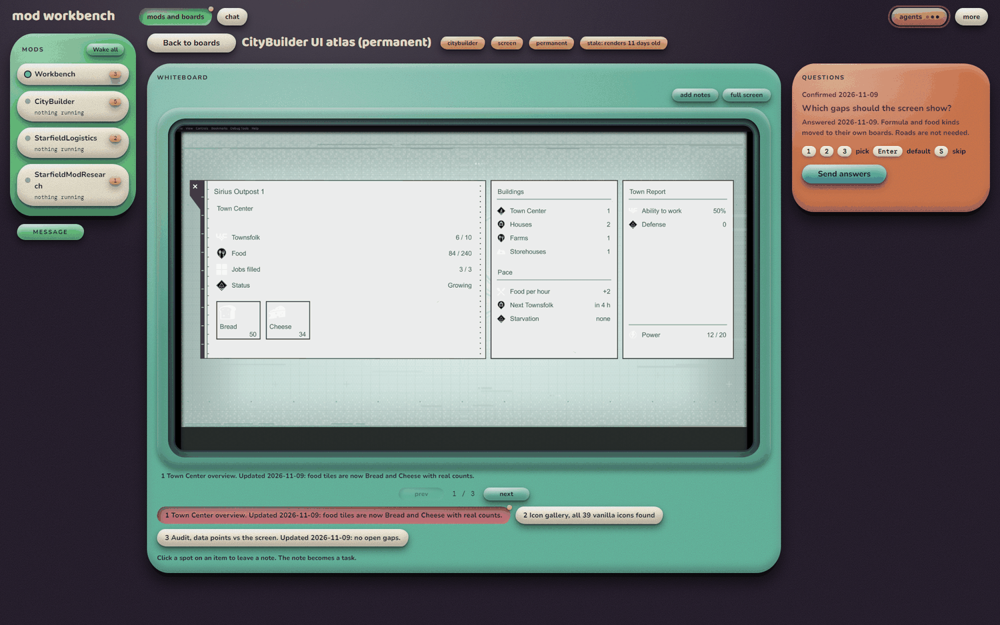
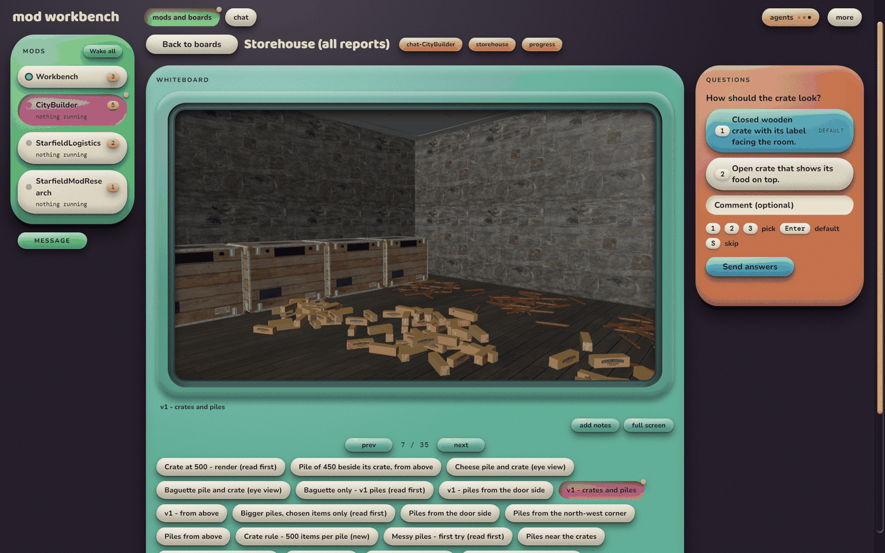
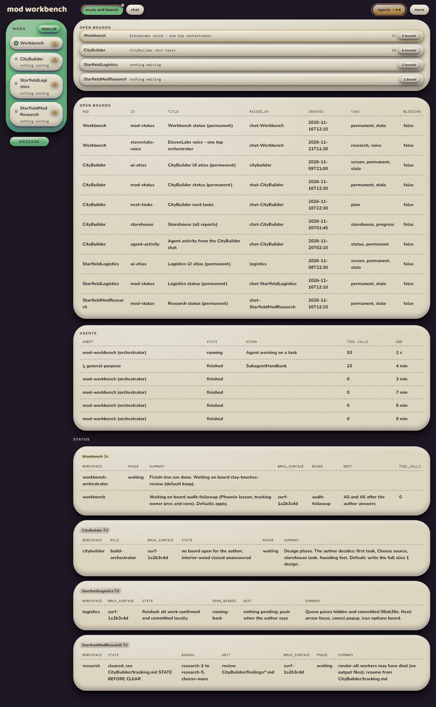

# mod-workbench

mod-workbench is a local web app for one person. AI agents put boards on it: questions, drafts and screenshots.
The human author reads each board in a browser and answers there, not in a chat window.
Each question has a default answer, so the agents do not wait. It was built for Starfield mod work.

## Screenshots

The whiteboard shows whatever an agent needs to ask about. Here it shows a UI mock for a town screen.



Here it shows a 3D render, with a question about it on the right.



The agents view lists each orchestrator and its subagents, with state, tool calls and age.



## Requirements

- Windows. The app uses Windows toast notifications and Windows scripts.
- Python 3.11 or later.
- Optional: Claude Code. The web chat uses the Claude Agent SDK, and two scripts are Claude Code hooks.
- Optional: OpenCode. The GLM chat starts an `opencode serve` process.
- Optional: wmux. The message box can type text into wmux terminal panes.

## Install and run

```
python -m venv .venv
.venv\Scripts\python -m pip install fastapi uvicorn watchfiles pyyaml winotify pillow claude-agent-sdk==0.2.180 httpx pytest pytest-asyncio
set WORKBENCH_ROOTS=<folder that holds your mod repos>
.venv\Scripts\python -m workbench serve
```

Open http://127.0.0.1:8760 in a browser. Use `--port` or `WORKBENCH_PORT` to change the port.
`start-workbench.cmd` runs the same command. Edit its `WORKBENCH_ROOTS` line first.
Separate several root folders with `;`. Each mod repo needs a `workbench.toml`.
Run `python -m workbench init <repo> --name <name>` to make one.

The package list above copies `pyproject.toml`. The project itself does not install with `pip install -e .`.

## Safety

- The server is for one user. It listens on 127.0.0.1 only. Never bind it to 0.0.0.0.
- The web chat runs Claude sessions with permission mode `auto` (`workbench/sdk_client_factory.py`). The session approves many tool calls without a prompt.
- The app can type text into wmux terminal panes (`workbench/pane_sender.py`).
- `scripts/activity_hook.py` and `scripts/stop_gate.py` are Claude Code hooks. The stop gate can block an agent from stopping when it has no open board.
- The GLM chat starts `opencode serve` on its first turn (`workbench/opencode_server_process.py`).

## Tests

```
.venv\Scripts\python -m pytest
```

## Docs

Design notes and guides are in `docs/`.
