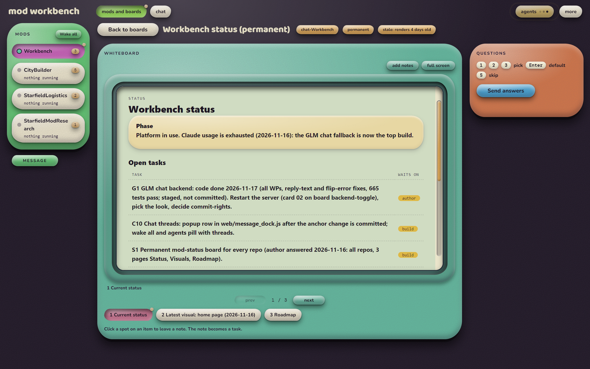
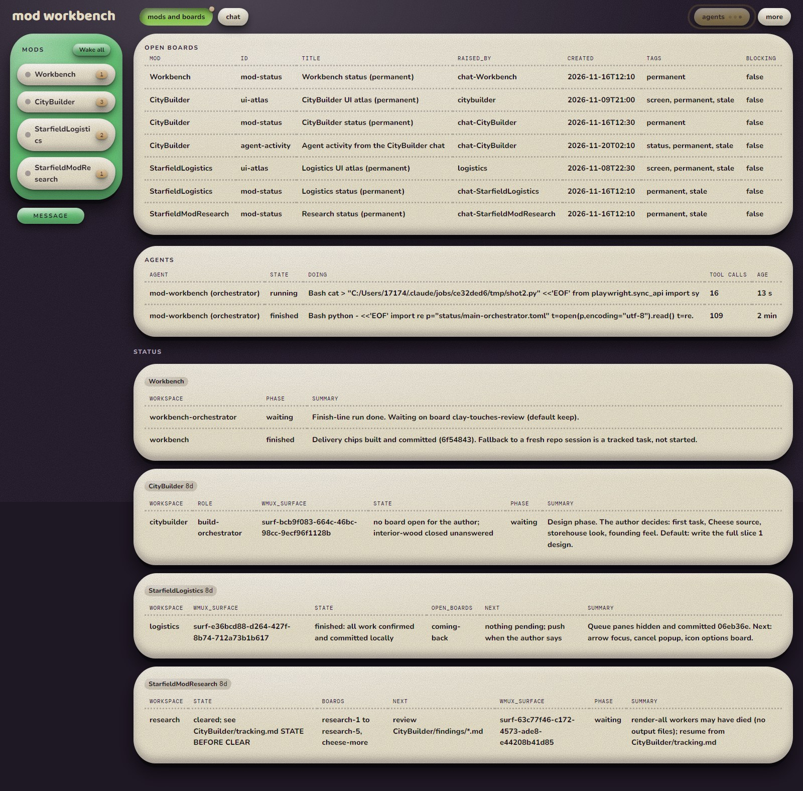

# mod-workbench

A local control room for running several AI coding agents across several repos. It is a web app plus a set of files, hooks and scripts. You run the agents. The workbench shows what they do, queues what they need from you, and records the result.

I built it to run a build machine for Starfield mods: research agents, build agents and cheap worker agents, all working at once. Nothing in the core is specific to Starfield. It expects Windows.

## What it does

### Boards

An agent that needs a decision writes a board: a question, a draft, a render or a screenshot. You answer in the browser. Every question has a default, so agents keep working while you decide. A non-default answer becomes a rework brief.

### Agent overview

One page lists every repo and every agent, and whether each agent is working or idle. Hooks in the agents' sessions write this state to disk.

### Orchestration

Each repo has one orchestrator agent. It splits work into small tasks, sends them to cheap worker agents (OpenCode, GLM by default), reviews the results and commits. You can message any agent from the page, or wake all orchestrators to audit their tasks.

### Chat

Talk to Claude (Agent SDK) or OpenCode agents from the page. You can also type into agents that already run in a wmux terminal pane.

### Guard rails

A stop hook stops an agent from going idle while it still owes you a board. Agents never wait for you. They continue on defaults.

### Task tracking

A master `tracking.md` lists each repo's open tasks and what waits on you. Handoff prompts carry a finished task into a clean session.

### Housekeeping

Done boards are archived to zip files. Windows toasts warn you about blocking questions and failed tests.

## How it works

Plain files in each repo are the source of truth. There is no database.

1. Each repo has a `workbench.toml` that names its folders for boards, status, messages and tracking.
2. Agents write files: boards, status, replies.
3. A file watcher feeds the web page live. You answer there, and the server writes `answers.json`, notes and messages.
4. The server then tells the agent, by typing a line into its terminal pane or sending a chat turn.

## A typical session

1. Start the server and open the page.
2. Agents in each repo raise boards for what they plan and what they need.
3. You work down the queue. Blocking questions come first.
4. Agents get your answers, rework where needed and continue.
5. Each finished task ends with a handoff prompt and a fresh session.

## Screenshots

The whiteboard shows whatever an agent needs to ask about. Here it shows a UI mock for a town screen.


Here it shows a 3D render, with a question about it on the right.


A permanent status board shows each repo's phase and open tasks as a styled page.



The overview page lists open boards, agents with their state, and the status of every mod.



## Requirements

- Windows. The app uses Windows toast notifications and Windows scripts.
- Python 3.11 or later.
- Optional: Claude Code. The web chat uses the Claude Agent SDK, and two scripts are Claude Code hooks.
- Optional: OpenCode. The GLM chat starts an `opencode serve` process.
- Optional: wmux. The message box can type text into wmux terminal panes.

## Install and run

```
python -m venv .venv
.venv\Scripts\python -m pip install fastapi uvicorn watchfiles pyyaml winotify pillow claude-agent-sdk==0.2.180 httpx pytest pytest-asyncio
set WORKBENCH_ROOTS=<folder that holds your mod repos>
.venv\Scripts\python -m workbench serve
```

Open http://127.0.0.1:8760 in a browser. Use `--port` or `WORKBENCH_PORT` to change the port.
`start-workbench.cmd` runs the same command. It scans the folder that holds this repo, unless you set `WORKBENCH_ROOTS`.
Separate several root folders with `;`.

## Add your first project

The workbench shows only repos that have a `workbench.toml`. To add one:

```
.venv\Scripts\python -m workbench init <path to your repo> --name "My project"
```

This creates `boards/open`, `boards/done` and `status` in that repo. Then tell your agents to put questions on a board.
The board file format is in `docs/orchestrator-guide.md`. `docs/new-mod.md` has the full steps.
The agent rules in `docs/` mention Starfield mods. Edit them for your own project.

The package list above copies `pyproject.toml`. The project itself does not install with `pip install -e .`.

## Safety

- The server is for one user. It listens on 127.0.0.1 only. Never bind it to 0.0.0.0.
- The web chat runs Claude sessions with permission mode `auto` (`workbench/claude/sdk_client_factory.py`). The session approves many tool calls without a prompt.
- The app can type text into wmux terminal panes (`workbench/panes/pane_sender.py`).
- `scripts/activity_hook.py` and `scripts/stop_gate.py` are Claude Code hooks. The stop gate can block an agent from stopping when it has no open board.
- The GLM chat starts `opencode serve` on its first turn (`workbench/opencode/opencode_server_process.py`).

## Tests

```
.venv\Scripts\python -m pytest
```

## Docs

Design notes and guides are in `docs/`. Start with `docs/orchestrator-guide.md`.

## License

MIT. See `LICENSE`.
